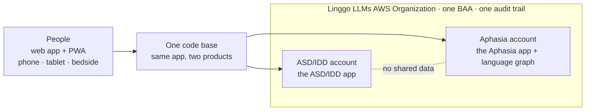
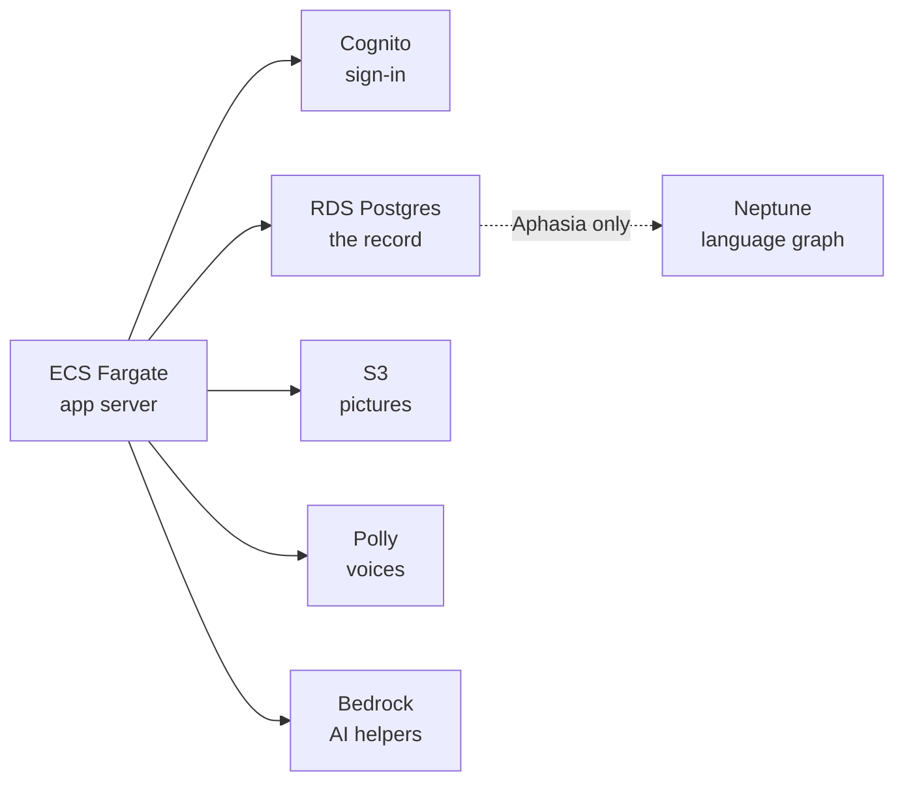
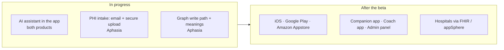

# Linggo LLMs

*One document: the company, the ten weeks, the architecture, the two products, the supporting repos, how the company runs, and the agents. Compiled November 1, 2026 from the GitHub organization README and the `linggollms-docs` repository. Account and resource identifiers, keys and anything identifying a person who uses the app are never written here.*

---

## Contents

1. [Linggo LLMs](#1-linggo-llms)
2. [Why the code is private](#2-why-the-code-is-private)
3. [The ten weeks](#3-the-ten-weeks)
4. [Architecture](#4-architecture)
5. [Linggo LLMs Aphasia](#5-linggo-llms-aphasia)
6. [Linggo LLMs ASD/IDD](#6-linggo-llms-asdidd)
7. [Supporting repos](#7-supporting-repos)
8. [COM Systems: how the company runs](#8-com-systems-how-the-company-runs)
9. [Agents](#9-agents)
10. [Patent, how we build, contact](#10-patent-how-we-build-contact)

---

## 1. Linggo LLMs

**AAC (augmentative and alternative communication) for people with little or no speech — rebuilt from the first line of code in ten weeks, by a clinician, in a HIPAA-covered AWS environment. Beta launched November 1, 2026.**

Linggo LLMs (Linggo USA Inc) gives children with autism or IDD and adults with aphasia, dementia or brain injury a way to speak: tap pictures, words or whole sentences and the device says them aloud, in the person's own language. Two products, one code base, five languages (English, Spanish, Arabic, Mandarin, French).

| Product | Who it is for | Repo | Status |
| --- | --- | --- | --- |
| **Linggo LLMs ASD/IDD** | Children and youth who need AAC; parents, teachers, therapists | `linggollms-asd-idd-webapp` (private) · [overview](#6-linggo-llms-asdidd) | Beta, web app + PWA |
| **Linggo LLMs Aphasia** | Adults after stroke, with dementia or brain injury; families, carers, SLPs | `linggollms-aphasia-webapp` (private) · [overview](#5-linggo-llms-aphasia) | Beta, web app + PWA |

The product code is private because it runs in a HIPAA-covered environment and serves people's health information. Everything that can be public about it is in [`linggollms-docs`](https://github.com/linggollms/linggollms-docs): architecture, history, each repo's overview, and how the company runs. [Why the code is private.](#2-why-the-code-is-private)

---

## 2. Why the code is private

The product repositories of Linggo LLMs are private. This page says why, and what a reader can see instead.

### The reasons

**The apps handle health information.** Linggo LLMs Aphasia and Linggo LLMs ASD/IDD store what a person says, their personal vocabulary and meanings, and their progress. In the United States that is protected health information when a hospital, clinic or health plan is involved, and we build as if it always is. The repos contain the schema, the access rules, the audit logging and the deployment templates for the environment that holds that data. Publishing them would hand anyone a map of the systems we are obliged to protect.

**The environment is HIPAA-covered and audited.** Both products run inside a Linggo LLMs AWS Organization under an organization-wide Business Associate Addendum, with CloudTrail, GuardDuty, AWS Config (HIPAA conformance pack) and Security Hub enabled. Security findings, remediation notes and infrastructure details live in the repos' `docs/` folders alongside the code. We are happy to walk an investor or partner through them under NDA; we do not publish them.

**The products are in beta.** Beta research runs on opt-in, with participants identified by number, not name. The repos hold survey logic, consent copy and the beta runbooks. Those are not secret, but they change weekly and are easy to misread out of context.

**Licensed content.** The library includes third-party symbol sets under licence. The code paths that handle them are not for redistribution.

### What is public instead

- This documentation repo: what each product is, how it is built, the architecture, the history, and how the company runs.
- The [organization README](https://github.com/linggollms): the ten-week story, the numbers, and the architecture map.
- Every repo's README, reproduced here under [apps/](#5-linggo-llms-aphasia) at the level of purpose, stack and status.

### What we will show on request

Under NDA, to investors, clinical partners and auditors: the repositories themselves, the AWS Config conformance results, the CloudTrail and Neptune audit log configuration, the architecture decision records (ADR-001 to ADR-015), the security scan results, and the beta research protocol. Write to admin@linggollms.com.

### What is never written anywhere public

Secrets, AWS account or resource IDs, IP addresses, instance IDs, and anything that identifies a learner, a family member or a clinician who uses the app. This rule is written into every repo's README and into `CLAUDE.md`, the working instructions the coding agent reads at the start of every session.

---

## 3. The ten weeks

September 4 to November 1, 2026. Dates come from the git history of the repos and from the repos' own `docs/` folders; nothing here is reconstructed from memory.

### Before

Linggo was founded by a Board Certified Behavior Analyst with years of AAC practice. Development began at the end of 2019, and the first beta was released in 2021, during COVID. The original product was a live AAC app used by families and clinicians: a Python Serverless Framework backend on AWS Lambda, API Gateway, Cognito, DynamoDB and S3, a self-managed Neo4j graph database on EC2, and a Flutter front end, built by a contracted development team. By late 2024 active development had stopped. The last meaningful commits to the original codebase are from September 2024; for the next twelve months the app ran, and nobody was building it.

### September 2026: the outage

In early September the Neo4j cluster behind the live app failed. Reads degraded, writes stopped, and the people who depended on Linggo to speak could not. The incident review that followed found what the new platform must never repeat: public access and exposed ports, credentials in repository history, no monitoring, untested backups. The developer was unreachable. The founder, who had never used a terminal, found and fixed the fault herself.

That was the turning point. The decision was not to patch the old system but to replace it: every line, in a new company (Linggo USA Inc, doing business as Linggo LLMs), in an environment built for health information from the first day.

### The rebuild

| When | What happened |
| --- | --- |
| **Sept 4** | First commit of the new codebase, from a TanStack Start template. The founder in the terminal with Claude Code as the coding agent; every change on a branch and a pull request from the start. |
| **Sept 10–18** | The heavy build: about 940 commits in two weeks. The Language Tree rebuilt to match how learners moved through the original app, My Words, Keyboard with predictions, Quick Chat, the caregiver Builder behind a PIN, a 3,593-word library (licensed symbol sets deliberately not shipped), photos and emoji with skin tones, Symbol Lab, five languages (English, Spanish, Arabic, Mandarin, French), cloud voices with device fallback, switch-control-friendly focus. |
| **Sept 16–17** | The first product decisions recorded as a numbered log with dates and reasons: no editing on the learner's screens, no auto-lock, no donations in the app until it is secured. |
| **Late Sept** | Security hotfixes (hashed PIN functions, admin-only clinician links); consumer-beta sign-up with an active consent checkbox and a stored consent record. |
| **Sept 30** | The adult (aphasia) product is specified. |
| **Early Oct** | The approach to the first version's hosting is set: treat its auth and data as an MVP layer, sync to a Linggo-owned GitHub repo from day one, plan the replacement before leaving. |
| **Oct 13–15** | ASD/IDD app: a demo board with a recorded voice, Scene Chat with AI suggestions, child starter topics, safety limits on codes, PINs and paid voices. The product and AI roadmap, the plan to move off the first host, and the HIPAA-controlled AWS environment plan are written. The database is rehearsed on plain Postgres: every migration applies. |
| **Oct 15–16** | **The move to AWS.** The managed database the first version ran on could not meet HIPAA requirements, and migrating users' language graphs later would only get harder. Cognito sign-in with a pre-token Lambda, PostgREST on RDS Postgres, S3 with signed links, Polly voices, Bedrock AI helpers; App Runner at first, replaced by ECS Fargate. The hosting and sync layer is removed. |
| **Oct 17** | **The Aphasia app restarts on AWS** as a copy of the ASD/IDD app's AWS branch. Adult starter topics in whole sentences, adult voices, adult library and Quick Chat. Database built from scratch and rehearsed locally the same day. |
| **Oct 17–22** | About 140 commits on the Aphasia app: opt-in beta research, the beta feedback survey, "Delete my account", the care-partner questionnaire with printable communication and wallet cards, Stop/Undo/"I'm not finished", phone layouts, "Keep me signed in". |
| **Oct 20** | The architecture target is written: the person owns their account for life, care settings borrow access, a bedside tablet is only borrowed; store apps via Capacitor; Neptune; FHIR and the Smile CDR appSphere gallery. |
| **Oct 21–22** | **The aphasia product gets its own AWS member account** inside a Linggo LLMs AWS Organization: organization-wide BAA accepted (the "Healthcare and Life Sciences" add-on deliberately declined, because it would let AWS de-identify our data for its own use); organization-wide CloudTrail; GuardDuty; AWS Config with the HIPAA conformance pack (130 checks); Security Hub. Four CloudFormation templates and one build script. Amazon Neptune built, IAM-only, encrypted with the app's own key, every query audited. Switched over October 22. |
| **Oct 22** | The care-team architecture is written: companions, coaches, admins, consent, access log, FHIR mapping. The research agent's evidence review of the v1 beta produces the build list for the next release. |
| **Oct 23** | **Aphasia beta live** at webapp-pwa.linggollms.com. PRD, technical requirements, UI/UX, app flow, backend schema and implementation plan written as a handover set. |
| **Oct 24–29** | PRD and TRD merged. The founder's decisions on the care side: a Companion app for parents and caregivers, a Coach app for clinicians, one consent at first invitation, the old coach app kept for data collection until the new one exists. A read-only look at the original company's AWS account finds about 2,900 registered users in its sign-in pools; they are to move into the new app after the beta. |
| **Nov 1** | **Both products in beta.** |

### By the numbers

2,049 unique commits and 179 merged pull requests across the organization in 58 days, by the founder working with Claude Code. Two AWS accounts built from CloudFormation. 253 database migrations rehearsed locally before deploy. 15 architecture decision records. A container security scan with seven findings, all in the Debian base image, none in Linggo's own code. Five languages. Two products.

### The decisions that shaped it

| Decision | When |
| --- | --- |
| One code base for children and adults; different content, voices and tone | Oct 17 |
| Only HIPAA-eligible AWS services touch what a person says; any outside voice or AI service needs a BAA or stays off | Oct 20–22 |
| The Aphasia app in its own AWS member account; the ASD/IDD app in the organization's main account | Oct 21, revised Oct 28 |
| Postgres is the record; Neptune sits beside it; the personal graph first, an anonymous shared graph (opt-in) later | Oct 20–22 |
| The person owns their account for life; organizations get time-limited access; a bedside tablet is only borrowed | Oct 20 |
| Data collection off by default; beta only, by number not name | Oct 19 |
| Amazon Nova as the default AI; Claude on Bedrock when unlocked | Oct 21 |
| No editing on the learner's screens; no auto-lock; email-only sign-in for now | Sept 16–17 |

---

## 4. Architecture

One document for both products. It says what the two apps share, what they keep separate, how the AWS environment is laid out, what is live, what is in progress, and what comes after the beta. Account and resource identifiers, network addresses and keys are never written down here or anywhere else public. Current as of November 1, 2026.

### The whole thing, in three pictures

**1. Two products, one code base, two accounts.** The apps never share data.

**2. Inside each account.** The same pattern in both; the graph exists only in the Aphasia account today.

**3. In progress, and after the beta.**

### The two apps, side by side

| | **Linggo LLMs ASD/IDD** | **Linggo LLMs Aphasia** |
| --- | --- | --- |
| Who | Children and youth with autism or IDD and little or no speech; parents, caregivers, teachers, therapists | Adults with aphasia (often after stroke), dementia or brain injury; families, carers, speech-language pathologists |
| Repo | `linggollms-asd-idd-webapp` (private) | `linggollms-aphasia-webapp` (private; its `docs/` is the platform's documentation of record) |
| Status | Beta, Nov 1, 2026, web app + PWA at webapp-dd.linggollms.com | Beta since Oct 23, 2026, web app + PWA at webapp-pwa.linggollms.com |
| Code | **Shared.** The Aphasia app began Oct 17 as a copy of the ASD/IDD app's AWS branch; the ASD/IDD repo is a git remote of the Aphasia repo, so fixes flow both ways | Same |
| What differs in code | Starter topics, voices, tone, default theme (purple Day Orchid), setup copy for parents and teachers, Scene Chat with AI suggestions, demo board with a recorded voice | Whole-sentence adult starter topics, adult voices, default theme (teal Calm Lagoon), setup copy for families and carers of adults, Stop/Undo/"I'm not finished", printable communication and wallet cards |
| Languages | English, Spanish, Arabic, Mandarin, French | Same |
| Board modes | Language Tree, My Words, Keyboard with predictions, Quick Chat, Scene Chat | Same five, adult content |
| Accessibility | Switch-access focus handling, accessible keyboards, full offline use, device-voice fallback | Same |
| AWS account | The Linggo LLMs account (also runs the Organization and the bill) | Its own member account, so health information is fenced off and an audit looks at one account |
| Compute | ECS Fargate, inside a private network | ECS Fargate, inside a private network |
| Sign-in | Own Cognito user pool | Own Cognito user pool |
| Database | Own RDS Postgres 16 via PostgREST, encrypted with the app's key | Own RDS Postgres 16 via PostgREST, encrypted with the app's key |
| Files | Own S3, signed links only | Own S3, signed links only |
| Graph | None yet; none planned until there is a real need | Amazon Neptune: each person's own language graph. IAM-only, audited, encrypted. Built; write path in progress |
| Voices | Amazon Polly, device fallback | Amazon Polly, device fallback; own-voice work in progress |
| AI | In-app AI assistant for questions and support, on Bedrock inside the account (in progress); Scene Chat suggestions | In-app AI assistant (in progress); meanings from the personal graph via Bedrock (in progress); Comprehend Medical for symptoms and medicines with standard codes (planned) |
| PHI intake | Not planned | By email (with a confidentiality addendum on every message) or by secure upload in the app; files land encrypted in the account, logged, and are processed inside the boundary (in progress) |
| Data they share | **None.** Separate sign-in, database and storage | None |
| Beta research | Opt-in, participants by number not name, off by default | Same, with de-identified team figures |
| Next | Store apps after beta | Store apps after beta; Companion app, Coach app, Admin panel; FHIR and Smile CDR appSphere for hospitals |

### What is shared

**One code base.** Both products are the same application with different content, voices, tone and theme. A fix to the keyboard, the offline cache or the switch-access focus order lands in one repo and is pulled into the other. This is the single biggest reason one person could build two clinical products in eight weeks.

**One design system.** Logo, palette, type and icons live in `linggollms-design-system` and guide the apps, the website and the Notion workspace.

**One AWS Organization.** One Business Associate Addendum covers every account, now and later. One CloudTrail trail records every account into one private, encrypted bucket. GuardDuty, AWS Config with the HIPAA conformance pack (130 checks) and Security Hub run in the account that holds health data. Each account's environment is created from the same four CloudFormation templates (base network, services, app, graph) and one build script, so a third product would get its own account the same way.

**One rule.** Only HIPAA-eligible AWS services touch what a person says. Any outside voice or AI service needs its own BAA or stays off. Every outside look at a person's information is recorded.

### What is kept apart

**Data.** The two products never share a database, a sign-in pool or a bucket. A child's words and an adult's words live in different accounts.

**Accounts.** The Aphasia product has its own AWS member account because it is the one heading into hospitals, where a HIPAA audit will want to see one boundary. The ASD/IDD product runs in the organization's account for now and would move to its own the day it needs to.

### Compute: ECS Fargate

Both app servers run on ECS Fargate inside each account's private network. App Runner, which the first AWS copies ran on in October, is no longer used: it is not on AWS's HIPAA-eligible list and could not reach the graph from inside the network. Fargate is eligible, private, and lets the app server, the database and the graph talk without ever touching the internet.

### The data layer

**Postgres is the record of everything.** Each product has its own RDS Postgres 16, reached through PostgREST with Cognito-issued tokens. Schema changes are versioned migrations rehearsed on a local Postgres before every deploy (139 in the Aphasia app, 114 in the ASD/IDD app, as of Nov 1, 2026).

**Neptune sits beside it** (Aphasia today) and links things so the app can understand one person better over time: a person → what they said → the words and pictures they used; each word → what it means for that person ("cold" meaning pain) → later a standard medical meaning (SNOMED CT); what they said → where they were (hospital, rehab, home); a person → the training they did → the words it practises. The person's own graph first; a shared, anonymous graph across people who opt in later. Reachable only inside the private network, IAM-only, every query audited and kept a year. This is where the patent work (US Application 18/452,469, *Assistive Communication Using Word Trees*) lives in the product.

### AI, inside the boundary

Everything AI runs on Amazon Bedrock inside the AWS account that holds the data: Amazon Nova by default, Claude when unlocked. Nothing a person says leaves the account to reach a model.

**In progress, both apps: an AI assistant inside the app.** A small helper for questions and support: how do I add a word, why is the voice not playing, what does this setting do. It runs on Bedrock in the same account as the app, so a question that mentions a person's words stays inside the boundary.

**In progress, Aphasia: PHI intake by email and secure upload.** A person, family member or care team will be able to send files (a discharge summary, a therapy report, a word list) in two ways: by email to an address that lands them, encrypted, in the Aphasia account's storage with the receipt logged, or through a secure upload in the app, which is being added so that documents never have to travel through a mail provider at all. Every email Linggo LLMs sends carries a confidentiality addendum. From storage the files are processed inside the boundary: Comprehend Medical (planned) to find symptoms, medicines and standard codes; Bedrock with the person's own graph to work out what matters for their board. Nothing is processed outside AWS, and both paths are built on HIPAA-eligible services with the organization BAA covering them.

**In progress, Aphasia: meanings from the graph.** Bedrock reads a person's own graph to work out what they most likely mean, and proposes words and sentences accordingly. This is the patent in practice.

### After the beta: store apps

Both products are web apps and home-screen PWAs today, on purpose: one build, every device, no store review between a fix and the people who need it. Native apps for the Apple App Store, Google Play and the Amazon Appstore (Fire tablets) come after the beta, built with Capacitor from the same code base. They will be offered first to the people who have had good experiences with Linggo over the years and want to explore the new AI features, so the first store reviews come from people who know what the app is for. Store apps also unlock what a bedside tablet needs: Guided Access on iPad, device management locks, a staff "End session" that clears the tablet without deleting the account.

### The lifelong account

The principle that drives all of this: the person owns their Linggo LLMs account for life. Someone with aphasia may first meet the app on a hospital tablet; their words, their meanings and their progress follow them to rehab, to outpatient therapy and home. A hospital, clinic or therapist is a care setting given access for a time; it never owns the account. A bedside tablet is only borrowed and is cleared for the next patient without deleting anything. Only the person, or a family member acting for them, can delete the account.

### Designed, not yet built

Companion app (parents and caregivers), Coach app (clinicians; the live version after the beta), Admin panel (clinics, schools, hospitals), store apps, hospital connections through FHIR and the Smile CDR appSphere gallery, the Neptune write path, the email PHI intake, the in-app assistants, and the move of the ASD/IDD product into its own account when it needs one. All are specified in the Aphasia repo's `docs/` and in architecture decision records ADR-001 to ADR-015.

---

## 5. Linggo LLMs Aphasia

An AAC (picture and text communication) board for adults who have lost some or all of their speech: aphasia after a stroke, dementia, or a brain injury. The person taps pictures, words or whole sentences and the device says them aloud. Built for the person first, and for the families, carers and speech-language pathologists around them.

Part of [Linggo LLMs](https://github.com/linggollms). Started October 17, 2026 as a copy of the ASD/IDD app, [Linggo LLMs ASD/IDD](https://github.com/linggollms/linggollms-asd-idd-webapp); the two share one code base and never share data.

**Status:** beta since October 23, 2026, web app and home-screen PWA at webapp-pwa.linggollms.com. This repo's `docs/` folder is the platform's documentation of record (PRD, TRD, architecture target, care-team architecture, Neptune, ADRs).

### What makes it the Aphasia app

- **Whole adult sentences.** Every starter tile says a complete message ("I need the bathroom.", "Please give me time to answer."), in English, Spanish, Arabic, Chinese and French.
- **Adult starter topics:** Talking With Me (speaking accommodations for aphasia, all on the page), Speaking Up, Small Talk, Daily Needs, Health and Care, Feelings, About Me, My Day, Home, Things I Enjoy, Out and About. Each topic shows its most important tiles first, then small folders with the rest.
- **Adult voices by default** (Amazon Polly, device fallback), and setup written for the families, carers and therapists of adults.
- **Stop / Undo / "I'm not finished"**, phone layouts, "Keep me signed in", printable communication and wallet cards, and "Delete my account" (the person owns their account for life; care settings only borrow access).
- **Opt-in beta research** with de-identified figures; data collection off by default.

Everything else (the board, Quick Chat, "+ More", typing, the Dashboard and Builder, pictures, offline use, switch access) works as in the ASD/IDD app.

### Where it runs

AWS, in its **own member account** ("Linggo LLMs Aphasia") inside the Linggo LLMs AWS Organization, so health information is fenced off and a HIPAA audit looks at one account. Built from CloudFormation (`deploy/aws/`, `scripts/aws-new-account.sh`): ECS Fargate (the app server, inside a private network), Cognito (sign-in), PostgREST on RDS Postgres 16 (the database, encrypted with the app's own key), S3 (pictures, signed links), Polly (voices), Bedrock (AI helpers: Amazon Nova by default, Claude when unlocked), and an **Amazon Neptune** graph (IAM-only, audited, HIPAA-eligible) for each person's own language. Organization-wide BAA, CloudTrail, GuardDuty, AWS Config with the HIPAA conformance pack, Security Hub.

Postgres is the record of everything. The graph sits beside it and links a person to what they said, to the words and pictures they used, and to what each word means for them (for example "cold" meaning pain), with standard medical meanings (SNOMED CT) to follow. Details: `docs/neptune.md`, `docs/own-aws-account.md`, `docs/architecture-target.md`.

### Stack

TypeScript · React 19 · TanStack Start · Vite · Bun · Drizzle ORM · PWA

### Rules for this repo

No secrets, account IDs, resource IDs, IP addresses, or anything that identifies a person who uses the app or their family. Documentation is written in plain words for clinicians, families and partners.

---

## 6. Linggo LLMs ASD/IDD

An AAC (picture and text communication) board for children and youth with autism or intellectual and developmental disabilities who have little or no speech, and for the parents, caregivers, teachers and therapists around them. The child taps pictures, words or whole sentences and the device says them aloud.

Part of [Linggo LLMs](https://github.com/linggollms). The Aphasia product, [Linggo LLMs Aphasia](https://github.com/linggollms/linggollms-aphasia-webapp), shares this code base with different content, voices and tone; fixes flow both ways. The two apps never share data.

**Status:** beta (November 1, 2026), web app and home-screen PWA at webapp-dd.linggollms.com. Replaces the original Linggo app (2021–2024, Flutter).

### What it does

- **Language Tree, My Words, Keyboard with predictions, Quick Chat, Scene Chat.** Five board modes, built to match how learners moved through the original Linggo so no one has to relearn.
- **Five languages:** English, Spanish, Arabic, Mandarin, French, including right-to-left and CJK layouts.
- **A 3,500+ word library** with photos and emoji (skin tones included), a Symbol Lab, and a caregiver Builder behind a PIN. No editing on the learner's screens.
- **Natural voices** (Amazon Polly) with device-voice fallback; a demo board with a recorded voice.
- **Accessibility:** switch-access-friendly focus handling, accessible keyboards, full offline use.
- **AI helpers** on Amazon Bedrock for suggestions (Scene Chat suggest-from-photo), behind safety limits on codes, PINs and paid voices.
- **Beta research, opt-in only.** Data collection is off by default; beta participants are identified by a number, not a name.

### Where it runs

AWS, in the Linggo LLMs account: ECS Fargate (the app server, inside a private network), Cognito (sign-in), PostgREST on Amazon RDS Postgres (the database), S3 (pictures), Polly (voices), Bedrock (AI helpers). Organization-wide BAA, CloudTrail, GuardDuty, AWS Config with the HIPAA conformance pack, Security Hub. Setup and settings: `docs/aws-app-settings.md`, `docs/two-apps.md`.

The first version of this app ran on Lovable (Supabase, Cloudflare) from September 4 to mid-October 2026. It moved to AWS because the managed database could not meet HIPAA requirements; the Lovable copy is frozen until its last user has moved.

### Stack

TypeScript · React 19 · TanStack Start · Vite · Bun · Drizzle ORM · PWA

### Rules for this repo

No secrets, account IDs, resource IDs, IP addresses, or anything that identifies a learner or their family. Documentation is written in plain words for clinicians, families and partners.

---

## 7. Supporting repos

Everything in the organization that is not one of the two products. Public ones can be opened directly; private ones are described here.

| Repo | Visibility | What it is | Started |
| --- | --- | --- | --- |
| `linggollms-design-system` | Private | Brand foundations: logo, color palette, type system. Linggo LLMs (Language and Learning Models) helps families, therapists and teachers give every learner a way to be heard, in the languages they live in; this repo is what that looks like. It guides the apps, the website and the Notion workspace, so one brand appears everywhere. | Oct 29, 2026 |
| `website-refresh-studio` | Private | The public website at linggollms.com: who we are, the two products, beta sign-up, policies, contact. Same stack as the apps (TypeScript, React 19, TanStack Start, Vite, Bun) so one set of components serves everything. | Oct 16, 2026 |
| `linggollms-animation-studio` | Private | In-house studio for animated training videos for families, SLPs, BCBAs, RBTs and teachers. **Why it exists:** there are no useful video creators that reflect the real lives of people with disabilities; most training video is sanitized and not appropriate for teaching this population, and AI video generators cannot simulate real scenarios because they have no real exposure to people with disabilities. So the founder is building one from the ground up: a cast of 58 characters with measured height charts, hand-drawn pose rigs and mesh rigs (breathing, blinking, head and arm gestures, lip-sync), real AAC screens captured per child and language, scene templates, a voice-led timeline editor, narration in the five product languages (a free local draft voice, paid release voices), and MP4 plus caption export. Runs entirely on the founder's own computer; no platform fees. Early working prototype, improving weekly. Private because it holds unreleased training content and the character library. | Oct 29, 2026 |
| `linggollms-ops` | Private | The Command Center robot: a GitHub Action that runs every morning, reads open pull requests and the week's merges from GitHub, the week's deliverables from Notion, and deployment status from both AWS accounts through a read-only role, and writes one live status line per workstream back into the operating system in Notion. No keys stored; nothing about people goes in. Private because it names the organization's internal workstreams and Notion structure. | Oct 30, 2026 |
| `socialmedia_agent` | Private | How Linggo LLMs plans and posts to social media: Postiz, an open-source scheduler run on our own AWS server; the script that puts network keys on the server without passing through chat; the change log. Rules: no secrets or IDs in the repo; nothing that identifies a learner, family or patient in a post; public words come from the website copy, brand voice and design system. Private because it documents the scheduler's hosting. | Oct 30, 2026 |

The two product repos are described on their own pages: [Linggo LLMs Aphasia](#5-linggo-llms-aphasia) and [Linggo LLMs ASD/IDD](#6-linggo-llms-asdidd).

Two further repos exist under the original company's GitHub organization (`mylinggo`) and are read-only history: the original Linggo codebase (2021–2024) and the bridge repo the new products were split from in September 2026.

---

## 8. COM Systems: how the company runs

Linggo LLMs is run by one person and a set of AI agents, inside one source of truth. The system that makes that possible is called **COM** (Central Operating Matrix). It is an AI-native operating system built on the ideas of EOS (the Entrepreneurial Operating System), designed and built by the founder in Notion over 2026, and later sold as a paid engagement to another startup. This page describes what it is and how it was built. It leaves out the internal vocabulary; the structure is what matters.

### The idea in one paragraph

Classical EOS assumes humans update static documents on a quarterly cycle: a vision page, quarterly goals, weekly to-dos, a weekly leadership meeting, an issues list, an accountability chart. COM keeps those shapes and makes them continuous. Goals, tasks, records and meetings live in databases, not pages. Agents read those databases, compute whether each goal is on trajectory, check whether each deliverable is actually done, and surface friction as it happens. The founder is asked for input only where judgment is required. Humans set strategy, priorities and trade-offs; agents handle capture, repeatable operations and synthesis; everything queryable lives in a database.

### How EOS maps to COM

| EOS | In COM |
| --- | --- |
| Vision / Traction Organizer | The long arc: the current year, the 3-year and 10-year horizons |
| Rocks (quarterly) | Quarterly goals, one to three per domain, each with one owner (human or agent) and a definition of done |
| Weekly to-dos | 7-day deliverables, five a week at most, each with one metric: a target and an actual |
| Level 10 meeting | An async weekly sync. One agent aggregates status across the others and escalates frictions for the founder's decision |
| Issues list (IDS) | A friction-anomaly system: detection and resolution tracked as records, not as a meeting agenda |
| Accountability chart | An agent registry: one owner per domain |

Each goal and deliverable has an ID, an outcome-shaped name, a definition of done with a date, one proving metric, and a status that is either trajectory (off track, at risk, on track, complete) or velocity (reached or not). Finished or retired work moves to an archive with its original name, so nothing is deleted and the record is auditable.

### The four layers

The system separates what is usually blurred together.

1. **Operating system (data and truth).** Dashboards and databases where work is planned, tracked and reviewed. Four "brains" in Notion: Company (operating system, operations, finance), Customer (revenue, partnerships, marketing), Dev (product and engineering), and Research and Education.
2. **Skills (procedures).** Reusable prompts that produce consistent outputs. A skill does a job; it does not own responsibility over time.
3. **Workers (role specs).** The job description for an AI role: mission and definition of done, ranked sources of truth and tie-breaker rules, three to six operating modes, required integrations, guardrails, success metrics. A worker can exist without an agent; an agent should never exist without a worker.
4. **Agents (executors).** The configured AI entity that runs the worker's skills with explicit permissions, integrations and triggers.

### How a new agent is built (the standard)

The order is deliberate, and it was learned by doing it wrong first.

1. Create or confirm the source-of-truth database the agent will read and write.
2. Write the worker spec: mission, modes, sources of truth, guardrails, metrics.
3. Write three to six skills.
4. Pilot manually for one to two weeks: the founder runs the skills by hand and refines the prompts and database properties.
5. Only then create the agent, with narrow write access, and wire the instructions page into it.
6. Two weeks of stable behaviour before status moves from Pilot to Live.

No agent goes live without six things filled in: a named human supervisor (one person, never a team), inputs, outputs, permissions (read versus write, and what it is barred from touching), an escalation path (the condition that stops it and who it goes to), and a definition of done anyone can check.

### Guardrails

Default to drafts and proposals when confidence is low or critical fields are missing. Require human confirmation for deleting, bulk edits, reparenting, changing sharing or permissions, or changing priorities. Every created record carries its source. Watch for four failure modes: silent drift outside scope, duplicates, overwriting a source of truth, and prompt bloat. Sensitive personal and health data stays out of the agent layer unless there is a specific reason and a compliance path, and for Linggo LLMs that means health data lives in AWS under a BAA, never in the operating-system layer.

### The human side: training people to work with agents

The part of COM the founder considers the durable asset is not the agents. It is a competency framework for the humans who supervise them, built with the Behavioral Skills Training method she used as a clinician: instruction, modelling, rehearsal, feedback, with mastery defined as observable behaviour, not attendance.

The failure mode it exists to prevent: a domain expert in an unfamiliar agentic environment becomes uncertain, over-relies on agent output, and loses agency. The target: the expert understands the environment, directs the agent, evaluates output, corrects errors, delegates deliberately, and stays the decision-maker. Ten competencies, from environmental fluency and agent literacy through instruction, decomposition, delegation, verification (catch seeded errors at an agreed rate), correction, orchestration, generalization to an unfamiliar agent, and independent agency. Maturity is staged: dependence, literacy, fluency, agency. Rehearsal happens against the client's live environment; the agents going live are the training stimuli.

### Built for Linggo LLMs, then sold

COM was built first to run Linggo LLMs itself, through the period when the company was being rebuilt by one person. In August 2026 an early-stage AI startup, met through a women-in-AI community, bought the system as a paid engagement: an eight-week Launch Lab in which the founder built their AI-native operating system in Notion across three machines (company, customer, product), delivered a baseline report, a leadership dashboard and data room, worker workspaces, a CRM sync, agent specifications, and a readiness assessment, and trained the team to run it independently. The engagement produced the reusable template the system is now packaged as: a playbook with engagement anchors, four source databases, a 7-day sprint structure, the six-field go-live gate, and the training framework above.

Everything client-facing is a duplicate of a master template; nothing in the master is shared with a client directly; patterns proven on an engagement are brought back to the master rather than left in the client's tree.

### Where it shows up in the GitHub organization

- [`linggollms-ops`](#7-supporting-repos): the Command Center robot, a daily GitHub Action that reads GitHub, Notion and AWS (read-only) and writes a live status line per workstream back into the operating system.
- [`socialmedia_agent`](#7-supporting-repos): the social media agent and the self-hosted scheduler it posts through.
- Each app repo's `CLAUDE.md` and `AGENTS.md`: the working rules the coding agent reads at the start of every session, which is COM's "worker spec" idea applied to engineering.
- The weekly product history and documentation map, generated from the repos and kept in Notion for reading and commenting.

See [Agents](#9-agents) for the agents themselves.

---

## 9. Agents

The agents that help run Linggo LLMs, described by what they do. Every one of them follows the standard in [COM Systems](#8-com-systems-how-the-company-runs): a worker spec first, skills second, a manual pilot, then the agent, with a named human supervisor, declared inputs, outputs and permissions, an escalation path and a definition of done. The supervisor for every agent today is the founder.

None of these agents touches health information. The operating-system layer (Notion, GitHub Actions, the scheduler) holds company records, research, public content and status; what a person says in the app lives in AWS under a BAA and is never read by any of them.

### Engineering

**Claude Code** is the coding agent for both products and every supporting repo. It works from `CLAUDE.md` and `AGENTS.md` in each repo (the engineering worker spec: what to read first, the checks before a pull request, the words we use, what never goes in a commit), on a branch, through a pull request. A catch-up script (`whats-new.sh`) lets every session start by reading what changed. Since September 4, 2026: 2,049 commits and 179 merged pull requests across the organization.

**Command Center robot** (`linggollms-ops`). A GitHub Action that runs every morning. It reads open pull requests and the week's merges from GitHub, the week's deliverables from Notion, and, read-only through a role that can only look, deployment and setup status from both AWS accounts. It writes one live status line per workstream into the operating system and saves a plain-text copy so any computer can read it. No keys are stored; no information about people goes in.

**AWS DevOps Agent** (AWS). Enabled on the accounts for backend troubleshooting; used for release-readiness checks until the founder dropped that check from pull requests in October to keep PR review in human hands.

### Research and clinical evidence

**Evidence review agent** (Acquired Communication Disorders research database, Notion). Reviews a release of the aphasia product against the AAC research base for its target population (adults with aphasia, dementia, brain injury) and produces a build list of what the evidence says to change before the next supervised users. Its October 2026 review of the v1 beta became `docs/reviews/2026-10-v1beta-handoff.md` in the aphasia repo. A companion research brain covers autism and IDD, with the rule that studies are weighed by whether their participants match the people the product serves: minimal to no speech, autism/IDD, acquired disorders.

**Competitor Observer** (weekly, Thursdays). Watches AAC and speech-device companies, AI communication startups, Big Tech accessibility and voice moves, and market shifts (Medicare/Medicaid, FDA, HIPAA, AAC research). Only real, dated news from the last 7 to 10 days; adds rows to the Competitor Watch database and posts a dated notice to the Company Intel Log.

**Grant Monitor** (weekly, Mondays). Finds open or upcoming non-dilutive funding that fits Linggo LLMs (AAC, autism, aphasia, assistive technology, communication access) from funder sites and aggregators, checks eligibility (U.S. for-profit, within six months) on the funder's own page, and adds rows to Funding Applications. It never applies.

### Operations

**Front desk / inbox router.** Triages incoming company email within 24 hours and routes each thread to the right database: a lead to the CRM, a receipt to expenses, a funding notice to grants, an investor message to the investor pipeline. Drafts and proposes; the founder confirms before anything is created or sent.

**Finance capture.** Turns receipts and bank transactions into clean expense records with a source link, flags missing fields, and supports the tax filings for a company that has operated in two countries.

**Grants and non-dilutive funding.** Tracks the SBIR and other grant pipeline: deadlines, requirements, drafts. Works with the Grant Monitor above.

**Investor relations.** Keeps the investor pipeline, pitch deck and data room current and drafts investor updates. Drafts only: nothing is sent without the founder's approval, and financial figures come from the finance records, not from the agent.

**Partnerships and CRM.** Owns the pipeline from first conversation to close; routes lead conversations from email into the CRM.

**Chief-of-staff / weekly sync.** Aggregates status across the other agents into the weekly sync, computes trajectory on quarterly goals and velocity on weekly deliverables, and escalates frictions for the founder's decision.

### Content and community

**Social media agent** (`socialmedia_agent`). Plans and posts through Postiz, an open-source scheduler Linggo LLMs runs on its own AWS server. Public words come from the website copy, the Notion brand voice and the design system; nothing that identifies a learner, family or patient goes into a post. Works on a branch; the founder merges.

**Training content and translation.** Turns research and product changes into training material for families, SLPs, BCBAs, RBTs and teachers, including CEU content and translation into the five product languages. The animation studio (`linggollms-animation-studio`) is its production tool, and it exists because no available video creator reflects the real lives of people with disabilities: most training video is sanitized, and AI video generators cannot simulate scenarios they have never seen. A 58-character cast with measured heights, hand-drawn and mesh rigs, real AAC screens per child and language, five-language narration, MP4 and caption export, all running on the founder's own computer.

**Brand.** The Linggo LLMs design system (logo, palette, type, icons, voice) lives as a Claude design system and in `linggollms-design-system`; it guides the Notion pages, the apps and the website so one brand appears everywhere.

### The go-live gate, for every agent

| Field | What it must say |
| --- | --- |
| Supervisor | One named human |
| Inputs | Source systems, databases, documents, triggers |
| Outputs | What it produces and where it writes |
| Permissions | Which systems, read vs write, what it is barred from touching |
| Escalation path | The condition that stops it, and who it goes to |
| Definition of done | How anyone can tell it is working |

Agents are reviewed quarterly: instructions re-read against current scope, skills checked, guardrails tightened, changes logged, and any agent whose instructions changed is run manually for a week before its triggers are re-enabled.

---

## 10. Patent, how we build, contact

### Patent

US Patent Application 18/452,469, *Assistive Communication Using Word Trees*: predicting what a person is trying to say from a graph of their own language, with the clinician and family in the loop to train it. Prosecution is ongoing; the Neptune graph above is where it lives in the product.

---

### How we build

- **Clinician-led.** The founder is a Board Certified Behavior Analyst (M.ADS, BCBA) with years of AAC practice. Product decisions are logged with dates and reasons (`docs/logic/decisions.md`), and an evidence-review agent checks each release against the AAC research base for the target population (minimal to no speech; autism/IDD; acquired disorders).
- **AI-native.** The founder builds with Claude Code; agents run research, competitor tracking, ops checks and social. The company runs on an AI-native operating system ([COM Systems](#8-com-systems-how-the-company-runs)) in Notion, with humans making every decision that touches a person's data. [The agents.](#9-agents)
- **Plain words.** Documentation is written for clinicians, families and partners, not just developers.

**Contact:** Ling Ly Tan, Founder and CEO · admin@linggollms.com · [linggollms.com](https://linggollms.com)
