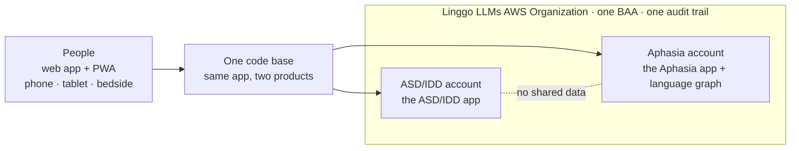
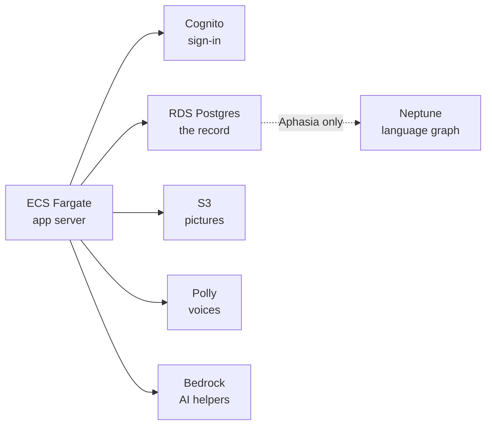
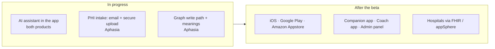

# Architecture: Linggo LLMs ASD/IDD and Linggo LLMs Aphasia

One document for both products. It says what the two apps share, what they keep separate, how the AWS environment is laid out, what is live, what is in progress, and what comes after the beta. Account and resource identifiers, network addresses and keys are never written down here or anywhere else public. Current as of November 1, 2026.

## The whole thing, in three pictures

**1. Two products, one code base, two accounts.** The apps never share data.

**2. Inside each account.** The same pattern in both; the graph exists only in the Aphasia account today.

**3. In progress, and after the beta.**

## The two apps, side by side

| | **Linggo LLMs ASD/IDD** | **Linggo LLMs Aphasia** |
| --- | --- | --- |
| Who | Children and youth with autism or IDD and little or no speech; parents, caregivers, teachers, therapists | Adults with aphasia (often after stroke), dementia or brain injury; families, carers, speech-language pathologists |
| Repo | `linggollms-asd-idd-webapp` (private) | `linggollms-aphasia-webapp` (private; its `docs/` is the platform's documentation of record) |
| Status | Beta, Nov 1, 2026, web app + PWA at webapp-dd.linggollms.com | Beta since Oct 23, 2026, web app + PWA at webapp-pwa.linggollms.com |
| Code | **Shared.** The Aphasia app began Oct 17 as a copy of the ASD/IDD app's AWS branch; the ASD/IDD repo is a git remote of the Aphasia repo, so fixes flow both ways | Same |
| What differs in code | Starter topics, voices, tone, default theme (purple Day Orchid), setup copy for parents and teachers, Scene Chat with AI suggestions, demo board with a recorded voice | Whole-sentence adult starter topics, adult voices, default theme (teal Calm Lagoon), setup copy for families and carers of adults, Stop/Undo/"I'm not finished", printable communication and wallet cards |
| Languages | English, Spanish, Arabic, Mandarin, French | Same |
| Board modes | Language Tree, My Words, Keyboard with predictions, Quick Chat, Scene Chat | Same five, adult content |
| Accessibility | Switch-access focus handling, accessible keyboards, full offline use, device-voice fallback | Same |
| AWS account | The Linggo LLMs account (also runs the Organization and the bill) | Its own member account, so health information is fenced off and an audit looks at one account |
| Compute | ECS Fargate, inside a private network | ECS Fargate, inside a private network |
| Sign-in | Own Cognito user pool | Own Cognito user pool |
| Database | Own RDS Postgres 16 via PostgREST, encrypted with the app's key | Own RDS Postgres 16 via PostgREST, encrypted with the app's key |
| Files | Own S3, signed links only | Own S3, signed links only |
| Graph | None yet; none planned until there is a real need | Amazon Neptune: each person's own language graph. IAM-only, audited, encrypted. Built; write path in progress |
| Voices | Amazon Polly, device fallback | Amazon Polly, device fallback; own-voice work in progress |
| AI | In-app AI assistant for questions and support, on Bedrock inside the account (in progress); Scene Chat suggestions | In-app AI assistant (in progress); meanings from the personal graph via Bedrock (in progress); Comprehend Medical for symptoms and medicines with standard codes (planned) |
| PHI intake | Not planned | By email (with a confidentiality addendum on every message) or by secure upload in the app; files land encrypted in the account, logged, and are processed inside the boundary (in progress) |
| Data they share | **None.** Separate sign-in, database and storage | None |
| Beta research | Opt-in, participants by number not name, off by default | Same, with de-identified team figures |
| Next | Store apps after beta | Store apps after beta; Companion app, Coach app, Admin panel; FHIR and Smile CDR appSphere for hospitals |

## What is shared

**One code base.** Both products are the same application with different content, voices, tone and theme. A fix to the keyboard, the offline cache or the switch-access focus order lands in one repo and is pulled into the other. This is the single biggest reason one person could build two clinical products in eight weeks.

**One design system.** Logo, palette, type and icons live in `linggollms-design-system` and guide the apps, the website and the Notion workspace.

**One AWS Organization.** One Business Associate Addendum covers every account, now and later. One CloudTrail trail records every account into one private, encrypted bucket. GuardDuty, AWS Config with the HIPAA conformance pack (130 checks) and Security Hub run in the account that holds health data. Each account's environment is created from the same four CloudFormation templates (base network, services, app, graph) and one build script, so a third product would get its own account the same way.

**One rule.** Only HIPAA-eligible AWS services touch what a person says. Any outside voice or AI service needs its own BAA or stays off. Every outside look at a person's information is recorded.

## What is kept apart

**Data.** The two products never share a database, a sign-in pool or a bucket. A child's words and an adult's words live in different accounts.

**Accounts.** The Aphasia product has its own AWS member account because it is the one heading into hospitals, where a HIPAA audit will want to see one boundary. The ASD/IDD product runs in the organization's account for now and would move to its own the day it needs to.

## Compute: ECS Fargate

Both app servers run on ECS Fargate inside each account's private network. App Runner, which the first AWS copies ran on in October, is no longer used: it is not on AWS's HIPAA-eligible list and could not reach the graph from inside the network. Fargate is eligible, private, and lets the app server, the database and the graph talk without ever touching the internet.

## The data layer

**Postgres is the record of everything.** Each product has its own RDS Postgres 16, reached through PostgREST with Cognito-issued tokens. Schema changes are versioned migrations rehearsed on a local Postgres before every deploy (139 in the Aphasia app, 114 in the ASD/IDD app, as of Nov 1, 2026).

**Neptune sits beside it** (Aphasia today) and links things so the app can understand one person better over time: a person → what they said → the words and pictures they used; each word → what it means for that person ("cold" meaning pain) → later a standard medical meaning (SNOMED CT); what they said → where they were (hospital, rehab, home); a person → the training they did → the words it practises. The person's own graph first; a shared, anonymous graph across people who opt in later. Reachable only inside the private network, IAM-only, every query audited and kept a year. This is where the patent work (US Application 18/452,469, *Assistive Communication Using Word Trees*) lives in the product.

## AI, inside the boundary

Everything AI runs on Amazon Bedrock inside the AWS account that holds the data: Amazon Nova by default, Claude when unlocked. Nothing a person says leaves the account to reach a model.

**In progress, both apps: an AI assistant inside the app.** A small helper for questions and support: how do I add a word, why is the voice not playing, what does this setting do. It runs on Bedrock in the same account as the app, so a question that mentions a person's words stays inside the boundary.

**In progress, Aphasia: PHI intake by email and secure upload.** A person, family member or care team will be able to send files (a discharge summary, a therapy report, a word list) in two ways: by email to an address that lands them, encrypted, in the Aphasia account's storage with the receipt logged, or through a secure upload in the app, which is being added so that documents never have to travel through a mail provider at all. Every email Linggo LLMs sends carries a confidentiality addendum. From storage the files are processed inside the boundary: Comprehend Medical (planned) to find symptoms, medicines and standard codes; Bedrock with the person's own graph to work out what matters for their board. Nothing is processed outside AWS, and both paths are built on HIPAA-eligible services with the organization BAA covering them.

**In progress, Aphasia: meanings from the graph.** Bedrock reads a person's own graph to work out what they most likely mean, and proposes words and sentences accordingly. This is the patent in practice.

## After the beta: store apps

Both products are web apps and home-screen PWAs today, on purpose: one build, every device, no store review between a fix and the people who need it. Native apps for the Apple App Store, Google Play and the Amazon Appstore (Fire tablets) come after the beta, built with Capacitor from the same code base. They will be offered first to the people who have had good experiences with Linggo over the years and want to explore the new AI features, so the first store reviews come from people who know what the app is for. Store apps also unlock what a bedside tablet needs: Guided Access on iPad, device management locks, a staff "End session" that clears the tablet without deleting the account.

## The lifelong account

The principle that drives all of this: the person owns their Linggo LLMs account for life. Someone with aphasia may first meet the app on a hospital tablet; their words, their meanings and their progress follow them to rehab, to outpatient therapy and home. A hospital, clinic or therapist is a care setting given access for a time; it never owns the account. A bedside tablet is only borrowed and is cleared for the next patient without deleting anything. Only the person, or a family member acting for them, can delete the account.

## Designed, not yet built

Companion app (parents and caregivers), Coach app (clinicians; the live version after the beta), Admin panel (clinics, schools, hospitals), store apps, hospital connections through FHIR and the Smile CDR appSphere gallery, the Neptune write path, the email PHI intake, the in-app assistants, and the move of the ASD/IDD product into its own account when it needs one. All are specified in the Aphasia repo's `docs/` and in architecture decision records ADR-001 to ADR-015.
